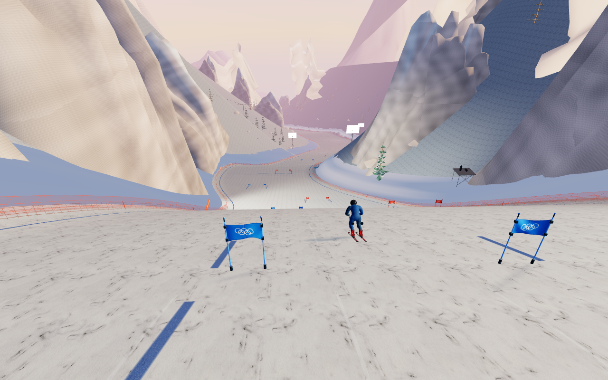
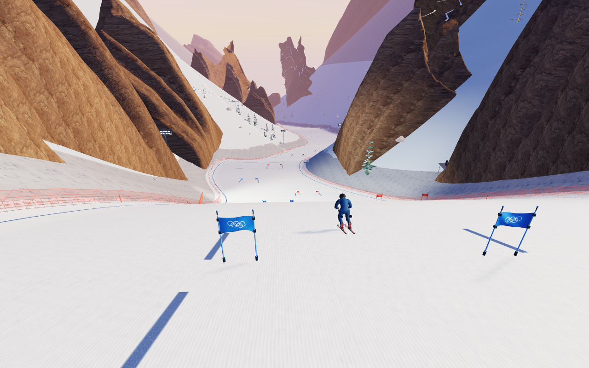
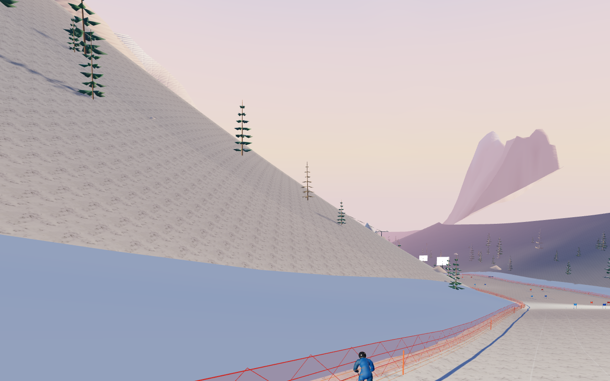
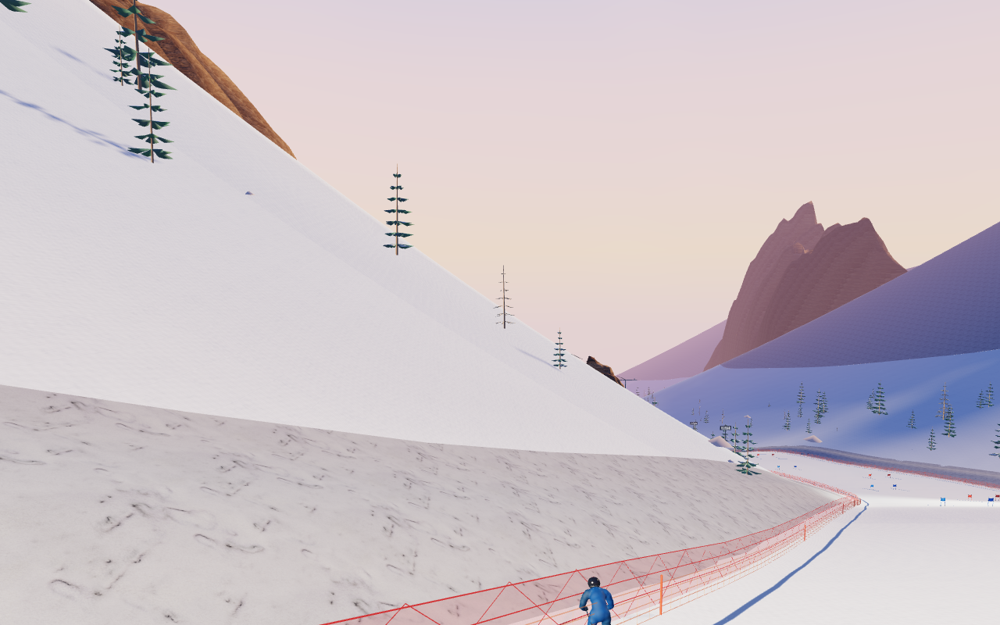
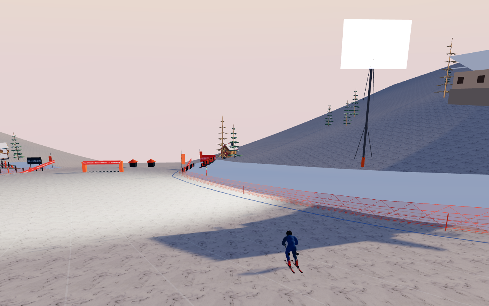
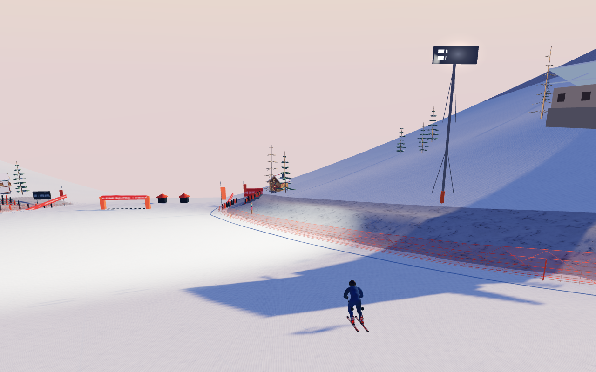

# Cortina — matières, relief et lumière, V1.18

Travail des 19–20 novembre 2026, référence Git `d4737c998a1297a707124cfe73ee553aa5bb01e2` (V1.17.1). Demande : amélioration importante des graphismes. PlayCanvas 2.24.1 conservé, sans deuxième moteur, achat ou remplacement du personnage.

## Intégration

- `alpine-pack.json`, `asset_audit.mjs`, `alpine-assets.ts` : Rock Face 03 de Poly Haven, CC0, couleur / normale OpenGL / ARM, partagées par les trois couches de falaises. Taille et MD5 vérifiées. Anciennes textures procédurales disponibles en repli.
- `cortina-geology.ts`, `cortina-scenery.ts`, `cortina-cinematic-detail.ts`, `cortina-reference-landmarks.ts` : densification des reliefs, plateaux de crête plus larges, profil gauche/droite orienté vers la vallée, fractures et strates à échelle métrique, UV, normales des falaises gauches corrigées et vraies corniches horizontales de neige. Ouverture du flanc droit du Schuss.
- `alpine-tree-geometry.ts`, `cortina-reference-landmarks.ts` : rameaux secondaires volumétriques pour les arbres proches, branches fines de mélèzes, ombres proches en Medium/High/Ultra. Géométrie regroupée par matériau, budgets par qualité ; aucun nouvel instancing revendiqué.
- `world.ts` : base de neige damée originale, normales fines, rugosité et anisotropie ; détail photographique Snow 02 en Medium/High/Ultra. Low évite les lectures de détail sur la neige et utilise une lumière ambiante uniforme au lieu de l’atlas d’environnement pour limiter le coût par pixel ; distance de brume claire corrigée dans le réglage effectivement appelé.
- `cortina-backcountry.ts` : prolongement du terrain hors du maillage central, à 220–560 m de l’axe, sous les massifs auparavant suspendus au-dessus du vide. Même champ de hauteurs, aucune modification de la piste physique ; un lot de rendu, tessellation selon qualité.
- `cortina-snow-banks.ts` : normales des deux bordures auparavant inversées, désormais orientées vers le ciel ; les grandes bandes bleues sans détail disparaissent. Snow 02 partagé sur les accumulations latérales. Test des normales dans les quatre profils.
- `cortina-light-accents.ts` : halos corrigés avec mélange additif tenant compte de l’alpha et base noire ; suppression des rectangles blancs opaques et des fausses nappes lumineuses sur la neige. Les vrais spots assurent l’éclairage du sol.
- `cortina-environment-light.ts`, `engine.ts` : atlas d’éclairage environnemental généré une fois par application, lumière directe chaude, lumière ambiante du ciel/neige, exposition. Le ciel visible reste le dôme original ; ses couleurs ne sont pas celles d’un relevé météo.
- `main.ts`, `capture-scenery.mjs` : inspection DEV aux mêmes coordonnées, caméra, résolution et qualité, sans toucher à la physique. Diagnostic des textures réellement assignées et de l’atlas. API absente du bundle de production.

## Comparaison

Captures synthétiques figées, **pas une course enregistrée ni une comparaison à un athlète réel**. Caméra arrière de diagnostic à 1280 × 800, Medium, WebGL 2, même personnage mobile et trois stations : Schuss 100 m, forêt 1 100 m, arrivée 2 010 m. Serveur Vite de référence isolé à partir de `d4737c9`, avec uniquement la même caméra DEV ajoutée.

`before-medium` : géométrie/rendu V1.17.1. `after-medium` : nouvelle version, après correction visuelle. `rejected-dark-ambient` : premier essai volontairement écarté, avec ciel surpeint et ombres trop sombres ; conservé pour retracer la boucle de validation. La correction désactive le passage skybox automatique et supprime une double conversion gamma de la radiance.

Les premiers fichiers de référence comportent des HTTP 403 de polices, dus au node_modules partagé du serveur Vite isolé ; le HUD était masqué et les ressources 3D ont chargé. La configuration locale de ce serveur a été corrigée ensuite. Ne pas présenter ces erreurs comme des erreurs de la version publique.

| Secteur | Avant V1.17.1 | Après V1.18 |
|---|---|---|
| Schuss |  |  |
| Forêt |  |  |
| Arrivée |  |  |

`after-high/schuss.png` et `after-ultra/forest.png` utilisent le personnage Full à 960 × 600 ; validation complémentaire de qualité, pas une comparaison de FPS avec les images Medium. Les deux scènes chargent sans erreur JS/HTTP ; elles montrent chacune deux vrais spots actifs et une ombre de spot. Les budgets maximaux restent respectivement trois et quatre spots selon la proximité. Les modèles de sapins importés et certaines silhouettes procédurales restent visiblement stylisés, particulièrement en Ultra.

## Validation

**TERMINÉ ET TESTÉ localement** : 176 tests unitaires / 39 fichiers ; 7 tests Chromium en 5,2 min ; TypeScript/Vite et audit du pack complet. Captures Medium (trois secteurs), High et Ultra (un secteur chacun) inspectées, sans erreur JS/HTTP. Régressions : commandes, chronométrage, départ, entraînement, rig Full/mobile et fallback, prises de carre, envol/réception, fanions et vrais spots. Journaux : `unit-tests.log`, `browser-tests.log`, `build.log`, `asset-audit.log`.

**TERMINÉ ET TESTÉ** : vrai bundle de production dans Chromium (`production-local.json/png`), zéro erreur JS/HTTP, API DEV absente, chronomètre et clavier actifs, 42 portes. La suite complète finale a été relancée après le réglage Low ; un essai intermédiaire a été interrompu volontairement pour appliquer ce réglage et ne compte pas comme une validation.

## Publication vérifiée

[V1.18 jouable](https://raphtd38-oss.github.io/alpine-ski-pro/?v=1.18.0), contrôlée le 20 novembre 2026. Commit de code `04b24ec0797e6252772409b2c11046c37b46a2c6`, [PR #45](https://github.com/raphtd38-oss/alpine-ski-pro/pull/45), fusion `5e8f1fe06f5c61fec3bc1e450d3fc829983d3555`. [Fichiers réellement modifiés](changed-files.txt).

- [CI de la PR](https://github.com/raphtd38-oss/alpine-ski-pro/actions/runs/44838316534) : 176 tests unitaires, 7 tests navigateur en 2,8 min, build et audit réussis.
- [CI de main et déploiement Pages](https://github.com/raphtd38-oss/alpine-ski-pro/actions/runs/44838876703) : mêmes 176 tests unitaires, 7 tests navigateur en 3,6 min, build, audit et déploiement réussis. L’arbre source de la fusion est identique à celui du commit testé.
- Contrôle indépendant du site public dans Chromium : aucune erreur JS/HTTP, API DEV absente, chronomètre et touches actifs, compteur de 42 portes. [Relevé](production-public.json) et [capture publique](production-public.png). Le relevé HUD précède la capture, ce qui explique leur différence de chronomètre.
- JavaScript public `index-CrDC7YZS.js` identique au build local, SHA-256 `459dcc0e4ce102500f3c1cf48840c87717921007395b57173826812e2beab498`. Les trois cartes de roche publiques ont les tailles et MD5 du manifeste, avec type MIME `image/jpeg` : [contrôle des fichiers servis](bundle-verification.json).

[Reçu de publication](release.json). La mise à jour finale de ces preuves ne modifie que la documentation ; le jeu publié est celui de la fusion `5e8f1fe` validée ci-dessus.

## Mesures réellement obtenues

Scène Low figée, 1100 × 720, WebGL 2, Chromium Linux **SwiftShader logiciel**, 35 intervalles d’images après 5 images de chauffe. Mesures successives sans autre navigateur de test concurrent. Les allocations PlayCanvas n’incluent pas toute la mémoire du navigateur. `profile-before.json` et `profile-after.json` font foi ; les profils intermédiaires sont conservés séparément et ne doivent pas être présentés comme la version finale.

| Mesure | V1.17.1 | V1.18 finale |
|---|---:|---:|
| FPS logiciels | 2,26 | 1,26 |
| Temps d’image moyen | 442,8 ms | 792,5 ms |
| P95 | 576,5 ms | 911,5 ms |
| Appels de rendu | 965 | 965 |
| Primitives rendues | 419 513 | 474 254 |
| Buffers/textures estimés | 97,7 MiB | 119,6 MiB |
| Chargement local | 6 983 ms | 6 961 ms |

Cette refonte **augmente le coût du rendu dans ce banc**. La simplification Low ne démontre pas un gain global de FPS : aucune optimisation de vitesse ni 60 FPS ne sont revendiqués. Ces chiffres ne prédisent pas les performances sur GPU matériel. Le choix Low conserve les photographies de roche, les cartes de neige et les spots, avec remplissage ambiant uniforme ; Medium/High/Ultra ajoutent l’atlas et les détails de neige.

Physique finale : cinq lots de 12 000 pas, **0,00233 à 0,00361 ms/pas** dans cette mesure isolée. Un spot actif sans ombre en Low à cette position, aucune particule active dans la fixture ; leur coût GPU séparé n’est pas mesuré. Les captures High/Ultra utilisent une autre résolution et un autre personnage : leurs compteurs ne constituent pas un benchmark comparatif de FPS.

## Limites et reprise

Relief encore artistique, sans DEM ni photogrammétrie locale. Certaines silhouettes et arbres restent stylisés ; ce lot n’établit pas un rendu AAA. Les détails lointains demandent encore un découpage spatial/LOD mesuré. WebGPU, Safari, smartphone et GPU joueur restent à vérifier. Les 42 portes, seuil de chute strictement >45 %, IK du personnage, contrôles, chrono et trajectoires ne sont pas modifiés par ce lot.

Les cinq vidéos utilisateur demeurent absentes, listées dans [l’audit des références](../2026-11-18/README.md). Aucune nouvelle analyse de vidéo ni mesure d’angle humain n’est revendiquée.
